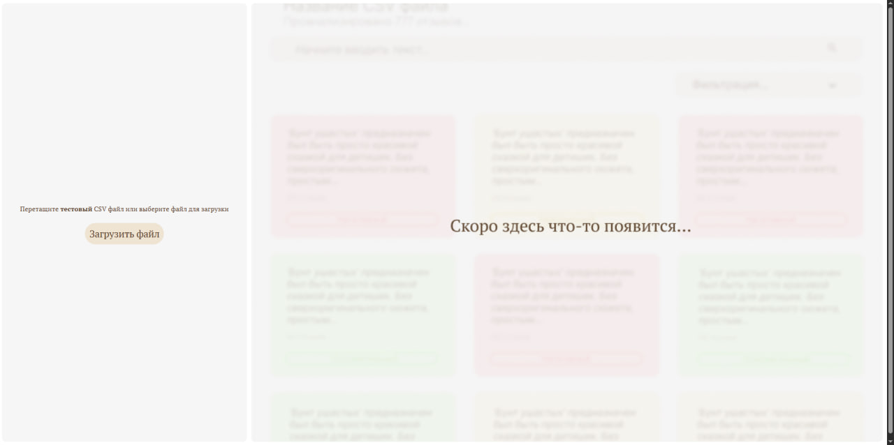
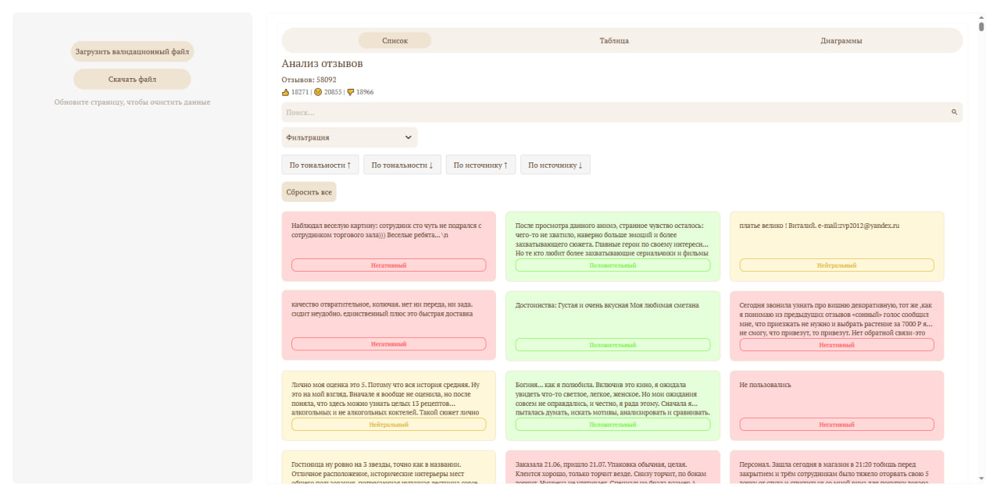
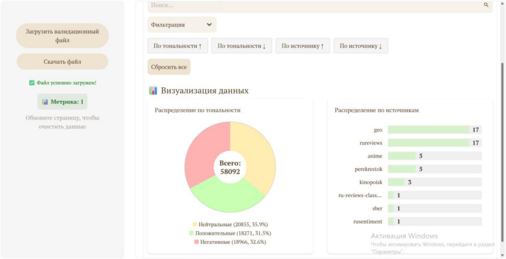
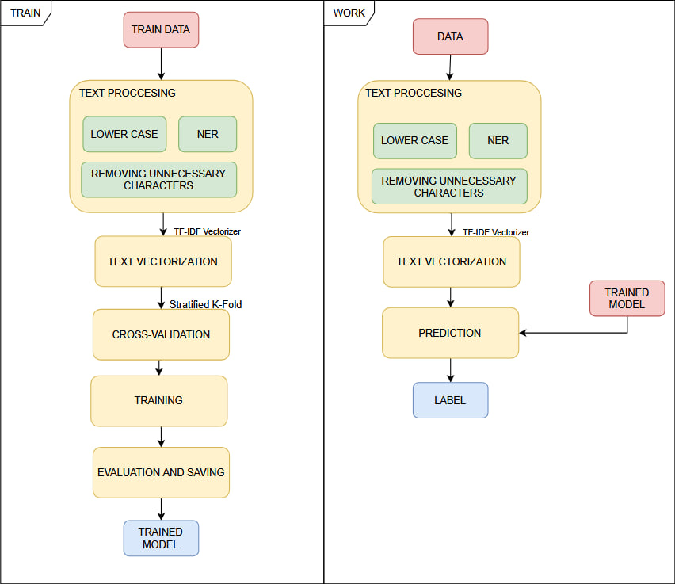

<div align="center">

# Sentify (Text Tonality Analyzer)

Приложение для определения тональности текста от команды ***«Ботанский клуб»***

</div>

Состав команды :
- Кульпин Егор – Backend  
- Матяшов Владимир – ML  
- Голев Семён – DS  
- Пастухова Зоя – Frontend  
- Фарисеева Арина – Frontend 

# О приложении

Наш проект представляет собой веб-приложение, способное анализировать тональность текста и ранжировать текст по 3-х бальной шкале, где:

| Оценка | Описание |
|:---:|:---|
| **0** | **Нейтральная** оценка |
| **1** | **Положительная** оценка |
| **2** | **Негативная** оценка |

В данной сфере очень важно правильно производить классификацию данных, визуализировать данные, чтобы облегчить их понимание, и возможность выгрузки файла с размеченными данными для дальнейшей работы.

Наше приложение предоставляет удобный интерфейс для пользователя, позволяющий загрузить свой *.csv* файл с данными и дальнейшим анализом этих данных. Анализ данных представляет из себя несколько возможных видов визуализации, а именно: 
 
 - Список, в котором отображаются отзывы с цветовой и текстовой пометкой об их тональности;
 
 - Таблица с отзывами, в которой есть такие столбцы как: отзыв, тональность, источник;
 
 - Диаграммы, которые представляют собой удобный дашборд, на котором с помощью диаграмм можно узнать информацию по загруженным данным.

Итоговый ответ для F1_macro представлен в файле submission.csv
Сайт работает [по ссылке](https://botclub.kulpin.online/)

| Главная страница | Таблица данных | Аналитика |
|:---:|:---:|:---:|
|  |  |  |

# Pipeline системы

Система построена на базе градиентного бустинга **LightGBM** и использует **TF-IDF** для векторизации текста.



### Технический стек и процесс

#### 1. Предобработка (Preprocessing)
*   Приведение к нижнему регистру.
*   Очистка от спецсимволов и лишних пробелов.
*   Замена сущностей (URL, email, даты, числа) на токены.

#### 2. Векторизация (Feature Engineering)
*   **TF-IDF Vectorizer**:
    *   Лимит: 40,000 признаков.
    *   N-граммы: униграммы, биграммы и триграмма.

#### 3. Модель (Model)
*   **LightGBM Classifier**:
    *   Обучение с кросс-валидацией (Stratified K-Fold, 3 фолда).
    *   Метрика оптимизации: **F1-macro score**.
    *   Сохранение модели и векторизатора через `joblib`.


# Запуск

Ниже представлены команды для локального запуска приложения
```bash
git clone https://hub.mos.ru/semengolev2005/botclub.git
cd botclub
```

```bash
docker-compose up -d
```

Приложение будет работать на http://localhost:3000